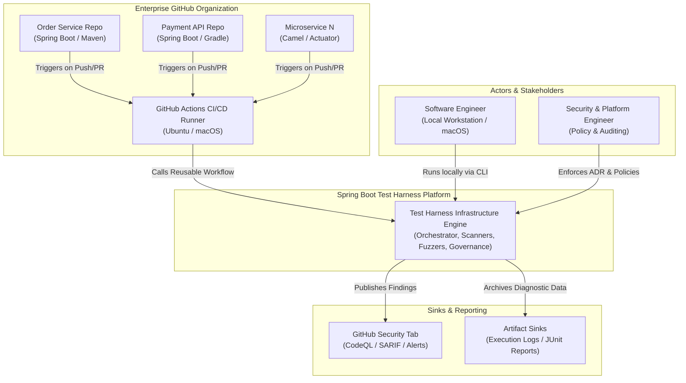
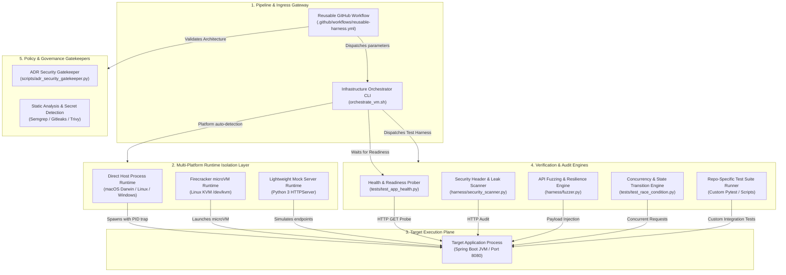
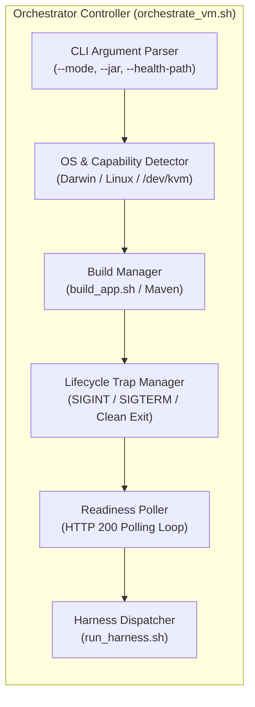

# Architecture Documentation: Spring Boot Test Harness Infrastructure

## Executive Summary
The Spring Boot Test Harness has evolved from a standalone testing script into a **Test-Harness-as-an-Infrastructure (THaaI)** platform. It provides an automated, multi-tenant security auditing, API fuzzing, and race-condition verification infrastructure that seamlessly targets heterogeneous Spring Boot microservices across an organization's portfolio of GitHub repositories.

By abstracting execution into pluggable runtime isolation tiers—ranging from native direct host execution on macOS and Windows to hardware-isolated Firecracker microVMs on Linux KVM—the platform delivers high-fidelity security validation locally on developer laptops and continuously within cloud CI/CD pipelines.

---

## C4 Model Architectural Views

### 1. C4 Level 1: System Context Diagram
The System Context diagram illustrates how developers, external GitHub repositories, and CI/CD pipelines interact with the Test Harness Infrastructure.



---

### 2. C4 Level 2: Container Diagram (Infrastructure Topography)
The Container diagram details the internal subsystems that constitute the Test Harness Infrastructure.



---

### 3. C4 Level 3: Component Diagram (Orchestration Controller)
The Component diagram breaks down [`orchestrate_vm.sh`](file:///Users/jsoehner/spring-boot-test-harness/orchestrate_vm.sh), the core operational agent that coordinates builds, readiness, and test dispatch.



---

## Infrastructure Deployment Architecture

The test harness infrastructure is designed for heterogeneous execution targets:

| Deployment Target | Environment | Runtime Mode | Isolation Mechanism |
| :--- | :--- | :--- | :--- |
| **Developer Laptop (macOS)** | macOS 14+ (Apple Silicon `aarch64` / Intel `x86_64`) | `direct` | Process-level isolation with automatic PID cleanup and background port forwarding. |
| **Developer Workstation (Linux/WSL2)** | Linux / WSL2 with KVM enabled | `firecracker` or `direct` | Hardware virtualization microVM isolation (`/dev/kvm`) or direct process. |
| **Standard CI/CD Runners** | GitHub-Hosted `ubuntu-latest` | `direct` | Containerized host runner process with dynamic artifact resolution. |
| **High-Assurance CI/CD Runners** | Bare-metal AWS EC2 / GCP with Nested Virt | `firecracker` | MicroVM virtualization with zero-persistence rootfs generation. |
| **Ephemeral Smoke Testing** | Any OS without Java / Maven | `mock` | Python mock HTTP daemon simulating endpoints. |

---

## Security Model & Isolation Tiers

### 1. Multi-Tier Isolation
- **MicroVM Tier**: On Linux systems with KVM, each test run executes within an immutable squashfs rootfs image. Memory and network are strictly partitioned from the host system.
- **Process Tier**: On macOS and non-KVM hosts, background processes are tracked via `.app_pid` and bound to `localhost` exclusively. POSIX shell traps guarantee that upon completion, error, or cancellation, all child processes are killed (`kill -15`).
- **Zero Persistence**: State does not cross pipeline boundaries; instances are ephemeral.

### 2. Architectural Decision & Security Governance
- **ADR Gatekeeper**: Architectural and security changes to sensitive directories (`auth/`, `security/`, `api/`, `crypto/`) require documented ADRs in [`docs/adr/`](file:///Users/jsoehner/spring-boot-test-harness/docs/adr).
- **SAST & Secret Gates**: All commits and pull requests undergo static security scans (Semgrep), dependency vulnerability auditing (Trivy), and secret leakage detection (Gitleaks).
- **Threat Model**: Standardized in [ADR 0001](docs/adr/0001-security-threat-model.md) and [ADR 0002](docs/adr/0002-test-harness-as-infrastructure-pipeline.md).

---

## Cross-Repository Consumer Integration

Any GitHub repository within your organization can integrate this infrastructure by adding a caller workflow:

```yaml
name: "Security & Concurrency Test Gate"

on:
  push:
    branches: [ main, develop ]
  pull_request:
    branches: [ main, develop ]

jobs:
  harness-audit:
    uses: jsoehner/spring-boot-test-harness/.github/workflows/reusable-harness.yml@master
    with:
      build-command: "mvn clean package -DskipTests"
      port: 8080
      health-endpoint: "/actuator/health"
      execution-mode: "direct"
      custom-tests-path: "tests/harness_tests"
    secrets: inherit
```

---

## Troubleshooting Guide

- **macOS Execution**: When running locally on macOS, Firecracker is automatically disabled in favor of Direct Execution Mode. Ensure Java 17+ and Maven are installed (`brew install openjdk@17 maven`).
- **Port Conflicts**: If port 8080 is in use, pass `--port <new_port>` to `orchestrate_vm.sh`.
- **Custom Health Routes**: Applications using non-actuator health endpoints (e.g., `/healthz` or `/ping`) can pass `--health-path /healthz`.
- **External JAR Auditing**: Skip the build step and test pre-compiled archives directly via `./orchestrate_vm.sh --jar /path/to/app.jar --skip-build`.
